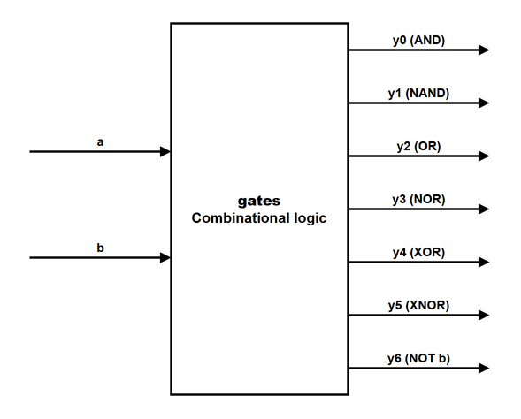

# [CH 1] Logic Gates

## 1. EDA & Board

---

## 2. Design Overview

Verilog로 디지털 회로의 기본 연산 7가지를 구현했습니다. 1비트 입력 `a`와 `b`를 바꿔 가며 AND, OR, XOR 계열의 연산과 반전 결과를 한 파형에서 비교할 수 있습니다.

[RTL 코드](rtl/gates.v)는 Verilog의 `assign`과 비트 연산자를 사용해 각 출력의 논리식을 정의합니다. `y6`은 입력 `b`의 반전입니다.

---

## 3. Block Diagram

`gates`는 같은 입력으로 7개 출력을 동시에 계산하는 조합논리 모듈입니다.

---

## 4. Simulation Scenario

[CH1_gates.xpr](CH1_gates.xpr)를 열고 시뮬레이션 최상위 모듈을 `tb_gates`로 선택한 뒤 **Run Behavioral Simulation → Run All**을 실행합니다. [테스트벤치](tb/tb_gates.v)는 클록 없이 입력 두 개의 모든 조합을 순서대로 인가하고 40 ns에 정지합니다.

| 시간 | 입력 `a, b` | 확인 목적 |
|---|---|---|
| 0~10 ns | 00 | 두 입력이 모두 0일 때 각 논리 연산 확인 |
| 10~20 ns | 01 | 서로 다른 입력과 `NOT b` 확인 |
| 20~30 ns | 10 | 입력 교환에 따른 출력 비교 |
| 30~40 ns | 11 | 두 입력이 모두 1일 때 각 논리 연산 확인 |

`o_y0~o_y6`을 다음 기대값과 비교합니다.

| a | b | y0 AND | y1 NAND | y2 OR | y3 NOR | y4 XOR | y5 XNOR | y6 NOT b |
|---|---|---|---|---|---|---|---|---|
| 0 | 0 | 0 | 1 | 0 | 1 | 0 | 1 | 1 |
| 0 | 1 | 0 | 1 | 1 | 0 | 1 | 0 | 0 |
| 1 | 0 | 0 | 1 | 1 | 0 | 1 | 0 | 1 |
| 1 | 1 | 1 | 0 | 1 | 0 | 0 | 1 | 0 |

테스트벤치는 파형 관찰용이며 자동 판정은 포함하지 않습니다.

[다음 실습 · 8비트 가산기](../CH2_adder/README.md)

---

## 5. Simulation Results

---

## 6. Demo

---
