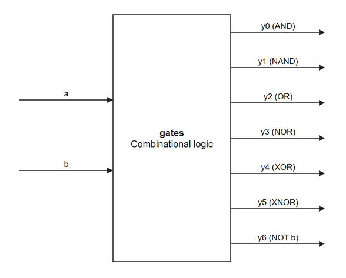

# CH1 · 기본 논리 게이트

Verilog로 디지털 회로의 기본 연산 7가지를 구현했습니다. 1비트 입력 `a`와 `b`를 바꿔 가며 AND, OR, XOR 계열의 연산과 반전 결과를 한 파형에서 비교할 수 있습니다.

## 블록 다이어그램

`gates`는 같은 입력으로 7개 출력을 동시에 계산하는 조합논리 모듈입니다.

## 설계와 시뮬레이션

[RTL 코드](rtl/gates.v)는 Verilog의 `assign`과 비트 연산자를 사용해 각 출력의 논리식을 정의합니다. `y6`은 입력 `b`의 반전입니다.

Vivado에서 [CH1_gates.xpr](CH1_gates.xpr)를 열고 **Run Simulation → Run Behavioral Simulation**을 실행합니다. [테스트벤치](tb/tb_gates.v)는 10 ns 간격으로 `00 → 01 → 10 → 11`을 입력합니다. 아래 기대값과 출력 파형을 비교할 수 있습니다.

| a | b | y0 AND | y1 NAND | y2 OR | y3 NOR | y4 XOR | y5 XNOR | y6 NOT b |
|---|---|---|---|---|---|---|---|---|
| 0 | 0 | 0 | 1 | 0 | 1 | 0 | 1 | 1 |
| 0 | 1 | 0 | 1 | 1 | 0 | 1 | 0 | 0 |
| 1 | 0 | 0 | 1 | 1 | 0 | 1 | 0 | 1 |
| 1 | 1 | 1 | 0 | 1 | 0 | 0 | 1 | 0 |

[다음 실습 · 8비트 가산기](../CH2_adder/README.md)
