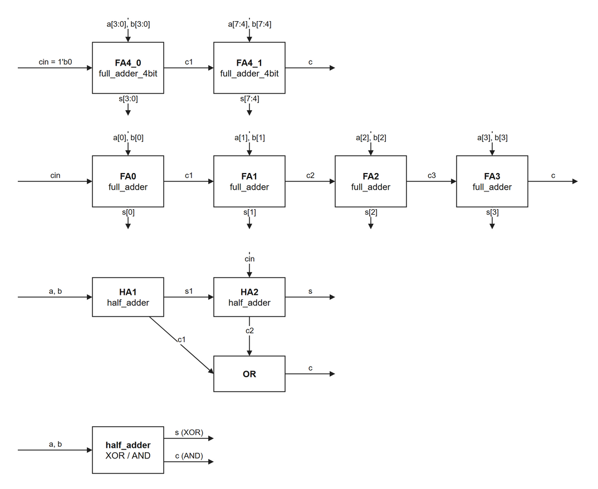

# CH2 · 8비트 리플 캐리 가산기

1비트 반가산기부터 시작해 두 8비트 값을 더하는 가산기를 구현했습니다. 작은 모듈을 재사용해 설계를 확장하고, 하위 비트에서 발생한 자리올림이 상위 비트 계산에 반영되도록 연결했습니다.

## 블록 다이어그램

하위 4비트 블록 `FA4_0`은 자리올림 입력을 0에서 시작합니다. 하위 블록에서 나온 `c1`은 상위 4비트 블록 `FA4_1`로 전달됩니다. 최종 결과는 8비트 합 `s`와 자리올림 `c`로 나뉩니다.

PNG에는 8비트 상위 구조와 함께 4비트 가산기, 1비트 전가산기, 반가산기의 신호 연결도 담았습니다.

## 모듈 구성

| 모듈 | 구현 |
|---|---|
| `half_adder` | XOR로 1비트 합을, AND로 자리올림을 계산합니다. |
| `full_adder` | 반가산기 두 개로 `a`, `b`, `cin`을 더하고, 두 자리올림을 OR로 결합합니다. |
| `full_adder_4bit` | 1비트 전가산기 네 개를 연결해 각 단계의 자리올림을 다음 단계로 보냅니다. |
| `adder` | 4비트 가산기 두 개를 연결해 8비트 합과 최종 자리올림을 출력합니다. |

[Verilog RTL](rtl/adder.v)

## 시뮬레이션

Vivado에서 [CH2_adder.xpr](CH2_adder.xpr)를 열고 **Run Simulation → Run Behavioral Simulation**을 실행합니다. 기본 시뮬레이션 최상위 모듈인 [tb_adder](tb/tb_adder.v)는 두 8비트 입력의 **65,536개 조합**을 10 ns 간격으로 인가합니다. 파형에서 `{c, s}`를 9비트 기대값과 비교할 수 있습니다.

| 입력 예시 | 기대 출력 | 관찰 포인트 |
|---|---|---|
| 15 + 1 | `c = 0`, `s = 16` | 하위 4비트의 자리올림이 상위 4비트 합에 반영됩니다. |
| 255 + 1 | `c = 1`, `s = 0` | 8비트 범위를 넘으면 최종 자리올림이 발생합니다. |

[반가산기 테스트벤치](tb/tb_half_adder.v)와 [1비트 전가산기 테스트벤치](tb/tb_full_adder.v)는 각각 4개와 8개의 입력 조합을 인가합니다.

> [!NOTE]
> [4비트 단독 테스트벤치](tb/tb_full_adder_4bit.v)는 `cin`을 연결하지 않습니다. 현재 RTL 기본 구성에서 이 테스트벤치만 따로 실행하면 합과 자리올림의 일부가 미정값(`X`)으로 나타날 수 있습니다.

[이전 실습 · 기본 논리 게이트](../CH1_gates/README.md)
