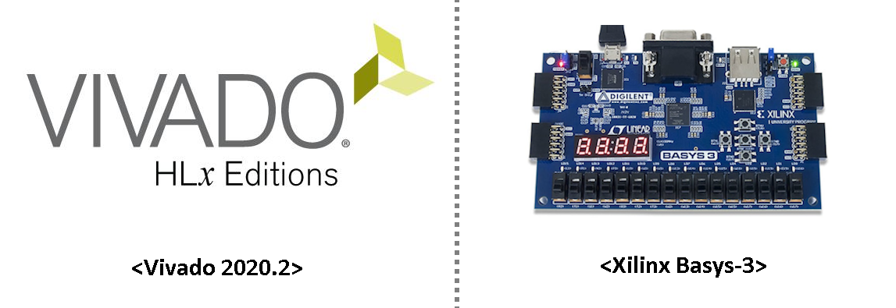
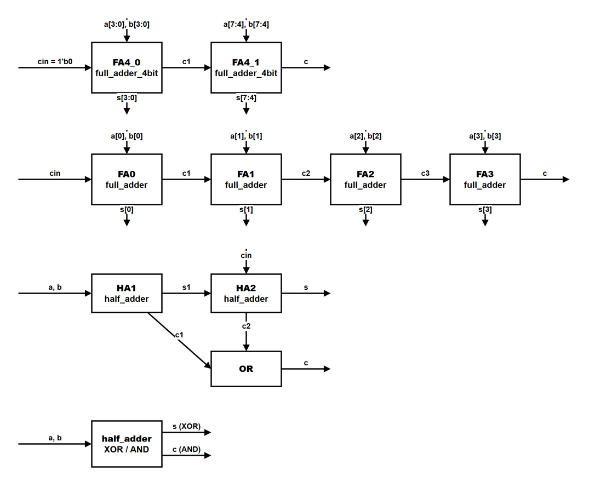

# [CH 2] 8-bit Ripple Carry Adder

## 1. EDA & Board

---

## 2. Design Overview

1비트 반가산기부터 시작해 두 8비트 값을 더하는 가산기를 구현했습니다. 작은 모듈을 재사용해 설계를 확장하고, 하위 비트에서 발생한 자리올림이 상위 비트 계산에 반영되도록 연결했습니다.

### 모듈 구성

| 모듈 | 구현 |
|---|---|
| `half_adder` | XOR로 1비트 합을, AND로 자리올림을 계산합니다. |
| `full_adder` | 반가산기 두 개로 `a`, `b`, `cin`을 더하고, 두 자리올림을 OR로 결합합니다. |
| `full_adder_4bit` | 1비트 전가산기 네 개를 연결해 각 단계의 자리올림을 다음 단계로 보냅니다. |
| `adder` | 4비트 가산기 두 개를 연결해 8비트 합과 최종 자리올림을 출력합니다. |

[Verilog RTL](rtl/adder.v)

---

## 3. Block Diagram

하위 4비트 블록 `FA4_0`은 자리올림 입력을 0에서 시작합니다. 하위 블록에서 나온 `c1`은 상위 4비트 블록 `FA4_1`로 전달됩니다. 최종 결과는 8비트 합 `s`와 자리올림 `c`로 나뉩니다.

PNG에는 8비트 상위 구조와 함께 4비트 가산기, 1비트 전가산기, 반가산기의 신호 연결도 담았습니다.

---

## 4. Simulation Scenario

[CH2_adder.xpr](CH2_adder.xpr)를 열고 기본 시뮬레이션 최상위 모듈 `tb_adder`로 **Run Behavioral Simulation → Run All**을 실행합니다.

### 8비트 가산기 전체 입력 조합

[tb_adder](tb/tb_adder.v)는 클록 없이 `a = 0~255` 각각에 대해 `b = 0~255`를 순회합니다. 한 조합을 10 ns 유지하므로 **65,536개 조합을 655,360 ns 동안** 인가한 뒤 정지합니다. 각 입력이 안정된 구간에서 9비트 출력 `{c, s}`가 `a + b`와 같은지 파형으로 확인합니다.

| 입력 예시 | 기대 출력 | 확인 목적 |
|---|---|---|
| 0 + 0 | `c = 0`, `s = 0` | 기본 합 |
| 15 + 1 | `c = 0`, `s = 16` | 하위 4비트에서 상위 4비트로 자리올림 전달 |
| 255 + 1 | `c = 1`, `s = 0` | 8비트 범위를 넘는 자리올림 |
| 255 + 255 | `c = 1`, `s = 254` | 최대 입력 조합 |

### 하위 모듈 개별 시나리오

아래 테스트는 해당 모듈을 시뮬레이션 최상위로 선택해 각각 실행합니다.

| 테스트벤치 | 입력 순서와 시간 | 확인할 출력 |
|---|---|---|
| [tb_half_adder](tb/tb_half_adder.v) | `(a,b) = 00 → 01 → 10 → 11`, 각 10 ns, 총 40 ns | `s = a ^ b`, `c = a & b` |
| [tb_full_adder](tb/tb_full_adder.v) | `(a,b,cin) = 000~111`, 각 10 ns, 총 80 ns | `{c,s} = a + b + cin` |
| [tb_full_adder_4bit](tb/tb_full_adder_4bit.v) | `a = 0~15` 각각에 대해 `b = 0~15`, 각 10 ns, 총 2,560 ns | 4비트 합과 자리올림 |

> [!NOTE]
> 4비트 단독 테스트벤치는 `cin`을 연결하지 않습니다. 현재 RTL 기본 구성에서는 일부 출력이 미정값(`X`)이 될 수 있으므로 정상적인 덧셈 기대값과 비교할 때 이 조건을 고려해야 합니다.

테스트벤치는 입력 자극과 파형 관찰용이며 자동 판정은 포함하지 않습니다.

[이전 실습 · 기본 논리 게이트](../CH1_gates/README.md)

---

## 5. Simulation Results

---

## 6. Demo

---
