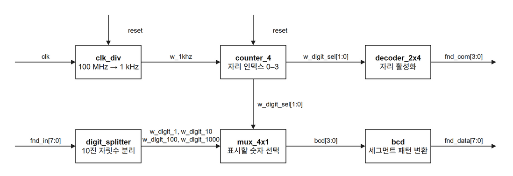

# CH3 · 4자리 7세그먼트 디스플레이 제어기

8비트 정수(0~255)를 10진수로 변환하고, 4자리 7세그먼트 디스플레이에 한 자리씩 표시하는 제어기를 Verilog로 구현했습니다. 각 자리를 순서대로 켜면서 세그먼트 신호를 공유하는 **시분할 구동** 방식입니다.

## 블록 다이어그램

## 설계 포인트

- **주사 타이밍** · `clk_div`는 100 MHz 입력에서 1 kHz 클록을 만듭니다. `counter_4`는 이 클록의 상승 에지마다 1의 자리부터 1000의 자리까지 순환합니다. 한 자리의 활성 시간은 정상 순환에서 1 ms이고, 같은 자리는 4 ms마다 다시 켜집니다.
- **10진수 변환** · `digit_splitter`는 나눗셈과 나머지 연산으로 각 자릿수를 구합니다. 8비트 입력 범위에서는 1000의 자리가 항상 0이며, 앞자리 0도 표시합니다.
- **자리와 숫자 동기화** · 같은 2비트 선택 신호 `w_digit_sel`이 `mux_4x1`과 `decoder_2x4`에 연결됩니다. `decoder_2x4`는 선택된 자리의 `fnd_com` 비트만 0으로 내려 활성화하고, `bcd`는 해당 숫자의 세그먼트 패턴을 `fnd_data`로 출력합니다.

[RTL 코드](rtl/fnd_controller.v)

## Vivado 시뮬레이션

Vivado 2020.2에서 [CH3_fnd.xpr](CH3_fnd.xpr)를 열고 **Run Simulation → Run Behavioral Simulation**을 실행합니다. [tb_fnd](tb/tb_fnd.v)는 100 MHz 클록을 만들고, 리셋을 10 ns 동안 인가한 뒤 입력을 `123`으로 유지하며 5.5 ms 동안 동작을 관찰하도록 구성되어 있습니다. 파형에서 아래 기대값을 비교하면 자리 선택과 숫자 출력이 함께 바뀌는지 확인할 수 있습니다.

| 활성 자리 | 표시 숫자 | `fnd_com[3:0]` | `fnd_data[7:0]` |
|---|---:|---|---|
| 1의 자리 | 3 | `1110` | `8'hB0` |
| 10의 자리 | 2 | `1101` | `8'hA4` |
| 100의 자리 | 1 | `1011` | `8'hF9` |
| 1000의 자리 | 0 | `0111` | `8'hC0` |

테스트벤치는 파형 관찰용이며 [파형 설정 파일](waveform/tb_fnd_behav.wcfg)을 포함합니다.
