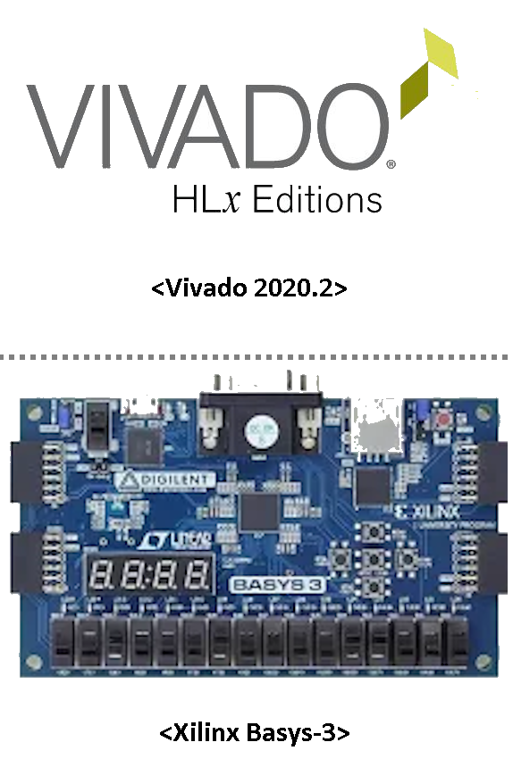

# CH4 · 10,000진 업·다운 카운터

# 1. EDA & Board

# 2. Design Overview

0~9999 범위에서 증가·감소하는 카운터를 Verilog로 구현하고, 현재 값을 4자리 7세그먼트 디스플레이로 출력하도록 구성했습니다. 모드 입력으로 방향 전환, 정지·재개, 클리어를 제어하며, 경계에서는 9999와 0 사이를 순환합니다.

### 설계 포인트

- **클록과 카운트 주기 분리** · `tick_gen`은 입력 클록 1,000,000주기마다 한 클록 폭의 틱을 생성합니다. 100 MHz 입력에서는 10 ms마다 카운트를 갱신합니다. 카운터는 원래 클록의 상승 에지에서 틱을 확인합니다.
- **제어 우선순위** · 비동기 활성 High 리셋을 우선하며, 이후 클리어 → 정지 → 틱에 따른 증가·감소 순서로 처리합니다. 클리어는 틱과 관계없이 다음 클록 상승 에지에서 반영됩니다.
- **경계값 순환** · 증가 시 `9999 → 0`, 감소 시 `0 → 9999`로 전환합니다. 정지와 모드 클리어 동안에도 틱 생성기는 계속 동작하므로 재개 시 기존 틱 주기를 따릅니다.
- **표시 모듈 재사용** · 이전 실습의 표시기 입력을 14비트로 확장했습니다. 10진 자릿수 분리, 숫자 선택, 세그먼트 변환을 거쳐 출력하며, 100 MHz 입력에서 1 kHz 자리 선택 클록으로 네 자리를 순환합니다.

[카운터·데이터패스 RTL](rtl/counter_10000.v) · [디스플레이 제어 RTL](rtl/fnd_controller.v)

### 모드 입력

| 입력 | 기능 | 동작 |
|---|---|---|
| `mode[2] = 1` | 클리어 | 방향·실행 설정에 우선해 카운트를 0으로 설정 |
| `mode[2:1] = 00` | 정지 | 현재 카운트 유지 |
| `mode = 010` | 증가 | 틱마다 1 증가 |
| `mode = 011` | 감소 | 틱마다 1 감소 |

`mode[0]`은 방향, `mode[1]`은 실행 허용, `mode[2]`는 클리어를 담당합니다. 앞자리 0을 포함해 네 자리를 표시합니다.

# 3. Block Diagram

최상위 모듈 `top_counter_10000`은 `datapath_10000`과 `fnd_controller`를 연결합니다. 그림의 `tick_gen`과 `counter_10000`은 데이터패스 내부 모듈입니다. 14비트 `w_counter`로 카운트 값을 표시기에 전달합니다.

# 4. Simulation Scenario

Vivado 2020.2에서 [CH4_counter_10000.xpr](CH4_counter_10000.xpr)를 열고 **Run Simulation → Run Behavioral Simulation**을 실행합니다. 기본 시뮬레이션 최상위 모듈은 `tb_datapath_10000`입니다.

[테스트벤치 파일](tb/tb_counter_10000.v)에는 다음 두 시나리오가 들어 있습니다. 두 테스트 모두 10 ns 주기 클록과 초기 리셋을 사용하며, 출력 파형을 관찰하도록 구성되어 있습니다.

| 테스트벤치 | 자극 순서 |
|---|---|
| `tb_datapath_10000` | 증가 100 ms → 감소 200 ms → 정지 100 ms → 재개 50 ms → 클리어 50 ms → 정지 50 ms → 감소 50 ms |
| `tb_top_counter_10000` | 증가 30 ms → 감소 60 ms → 정지 20 ms → 재개 20 ms → 클리어 20 ms |

파형에서 확인할 기대 동작은 다음과 같습니다.

| 관찰 항목 | 기대 동작 |
|---|---|
| 실행 중 틱 | `i_tick`이 반영되는 클록 상승 에지에서만 카운트 변화 |
| 정지·재개 | 정지 중 값 유지, 재개 후 다음 유효 틱에서 갱신 |
| 클리어 | 카운트가 0이 되고 클리어 유지 중 0 유지 |
| 클리어 후 감소 | 0에서 첫 유효 감소 틱에 9999로 순환 |
| 최상위 출력 | `fnd_com`이 `1110 → 1101 → 1011 → 0111`로 순환하고, 선택된 자릿수의 패턴이 `fnd_data`에 출력 |

현재 테스트벤치는 입력 자극과 파형 관찰용이며 자동 통과·실패 판정은 포함하지 않습니다. 모드 변경 시점이 틱 처리와 가까우므로 경계 시점은 `mode`, `i_tick`, `counter`를 함께 확인합니다.

# 5. Simulation Results

# 6. Demo
