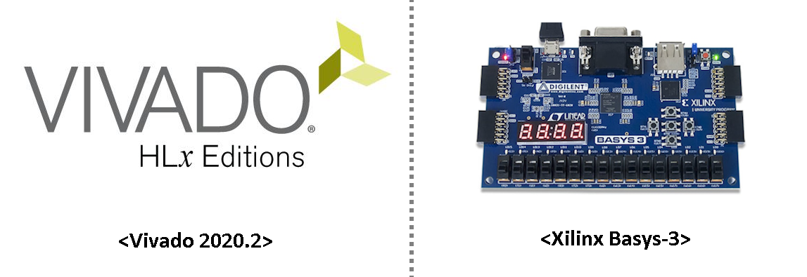
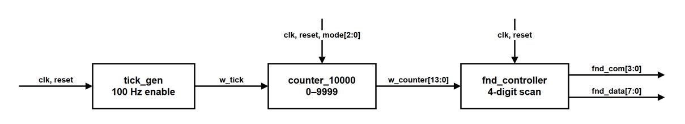

# [CH 4] Modulo-10000 Up-Down Counter

---

## 1. EDA & Board

---

## 2. Design Overview

0~9999 범위에서 증가·감소하는 카운터를 Verilog로 구현하고, 현재 값을 4자리 7세그먼트 디스플레이로 출력하도록 구성했습니다. 모드 입력으로 방향 전환, 정지·재개, 클리어를 제어하며, 경계에서는 9999와 0 사이를 순환합니다.

### 설계 포인트

- **클록과 카운트 주기 분리** · `tick_gen`은 입력 클록 1,000,000주기마다 한 클록 폭의 틱을 생성합니다. 100 MHz 입력에서는 10 ms마다 카운트를 갱신합니다. 카운터는 원래 클록의 상승 에지에서 틱을 확인합니다.
- **제어 우선순위** · 비동기 활성 High 리셋을 우선하며, 이후 클리어 → 정지 → 틱에 따른 증가·감소 순서로 처리합니다. 클리어는 틱과 관계없이 다음 클록 상승 에지에서 반영됩니다.
- **경계값 순환** · 증가 시 `9999 → 0`, 감소 시 `0 → 9999`로 전환합니다. 정지와 모드 클리어 동안에도 틱 생성기는 계속 동작하므로 재개 시 기존 틱 주기를 따릅니다.
- **표시 모듈 재사용** · 이전 실습의 표시기 입력을 14비트로 확장했습니다. 10진 자릿수 분리, 숫자 선택, 세그먼트 변환을 거쳐 출력하며, 100 MHz 입력에서 1 kHz 자리 선택 클록으로 네 자리를 순환합니다.

[카운터·데이터패스 RTL](rtl/counter_10000.v) · [디스플레이 제어 RTL](rtl/fnd_controller.v)

### 모드 입력

| 입력 | 기능 | 동작 |
|---|---|---|
| `mode[2] = 1` | 클리어 | 방향·실행 설정에 우선해 카운트를 0으로 설정 |
| `mode[2:1] = 00` | 정지 | 현재 카운트 유지 |
| `mode = 010` | 증가 | 틱마다 1 증가 |
| `mode = 011` | 감소 | 틱마다 1 감소 |

`mode[0]`은 방향, `mode[1]`은 실행 허용, `mode[2]`는 클리어를 담당합니다. 앞자리 0을 포함해 네 자리를 표시합니다.

---

## 3. Block Diagram

최상위 모듈 `top_counter_10000`은 `datapath_10000`과 `fnd_controller`를 연결합니다. 그림의 `tick_gen`과 `counter_10000`은 데이터패스 내부 모듈입니다. 14비트 `w_counter`로 카운트 값을 표시기에 전달합니다.

---

## 4. Simulation Scenario

[CH4_counter_10000.xpr](CH4_counter_10000.xpr)를 열고 **Run Behavioral Simulation → Run All**을 실행합니다. [테스트벤치 파일](tb/tb_counter_10000.v)에 데이터패스와 최상위 표시 출력용 시나리오가 각각 있습니다.

두 테스트 모두 10 ns 주기(100 MHz) 클록을 생성하고 처음 10 ns 동안 `reset = 1`을 인가합니다. 아래 시간은 **리셋 해제 시점을 0 ms로 한 경과 시간**입니다. 틱은 10 ms마다 발생하며, 표의 기대 동작을 `mode`, `w_tick`과 카운트 값으로 함께 확인합니다.

### 데이터패스 · 기본 시뮬레이션 대상

최상위 모듈을 `tb_datapath_10000`으로 선택합니다. `counter`를 직접 관찰하며 총 600 ms 동안 다음 순서로 실행합니다.

| 경과 시간 | mode | 기능 | 기대 동작 |
|---|---|---|---|
| 0~100 ms | `010` | 증가 | 유효 틱마다 1 증가 |
| 100~300 ms | `011` | 감소 | 유효 틱마다 1 감소, 0 다음에 9999로 순환 |
| 300~400 ms | `001` | 정지 | 틱이 발생해도 현재 값 유지 |
| 400~450 ms | `010` | 증가 재개 | 유지한 값에서 증가 재개 |
| 450~500 ms | `110` | 클리어 | 다음 클록 상승 에지에서 0, 이후 0 유지 |
| 500~550 ms | `000` | 정지 | 클리어 해제 후에도 0 유지 |
| 550~600 ms | `011` | 감소 재개 | 첫 유효 감소 틱에 0 → 9999, 이후 감소 |

### 최상위 · 디스플레이 연결 확인

최상위 모듈을 `tb_top_counter_10000`으로 바꾸어 별도로 실행합니다. 총 150 ms 동안 카운트와 표시 출력을 관찰합니다.

| 경과 시간 | mode | 기능 | 확인할 동작 |
|---|---|---|---|
| 0~30 ms | `010` | 증가 | 증가하는 카운트와 표시 숫자 비교 |
| 30~90 ms | `011` | 감소 | 0에서 9999로 순환하는 표시 확인 |
| 90~110 ms | `001` | 정지 | 카운트 값 유지, 자리 주사는 계속 동작 |
| 110~130 ms | `010` | 증가 재개 | 정지한 값에서 증가 |
| 130~150 ms | `110` | 클리어 | 표시 값이 0000으로 전환 |

`DUT.w_counter`와 `fnd_com`, `fnd_data`를 비교합니다. `fnd_com`은 `1110 → 1101 → 1011 → 0111`로 순환하고 `fnd_data`는 선택된 자릿수의 패턴을 출력해야 합니다.

모드 변경은 틱 처리와 가까운 시점에 발생하므로 구간 경계에서는 모드와 틱이 반영되는 클록 에지를 함께 확인합니다. 현재 테스트벤치는 파형 관찰용이며 자동 통과·실패 판정은 포함하지 않습니다.

---

## 5. Simulation Results

---

## 6. Demo

---
